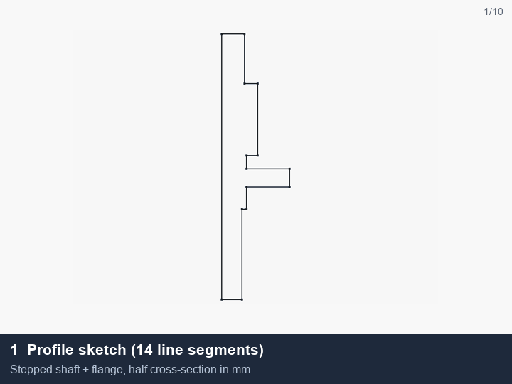
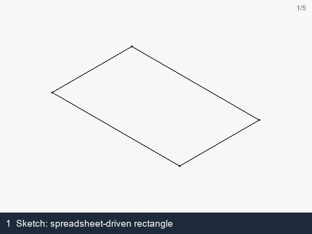
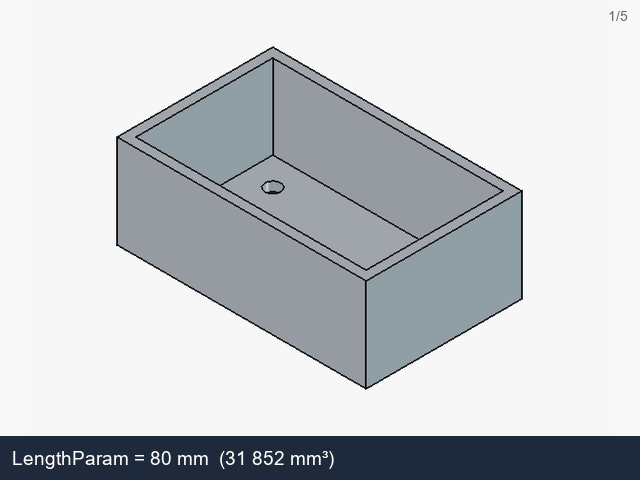
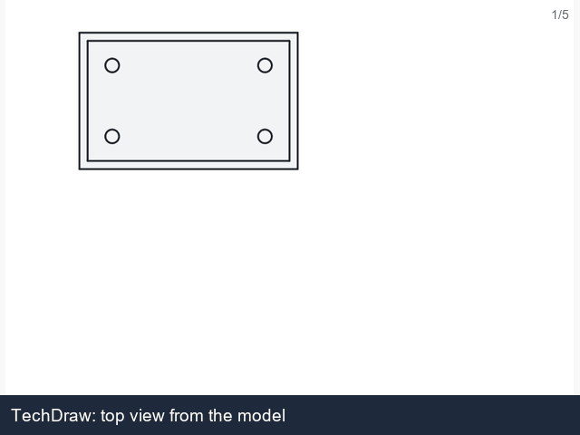
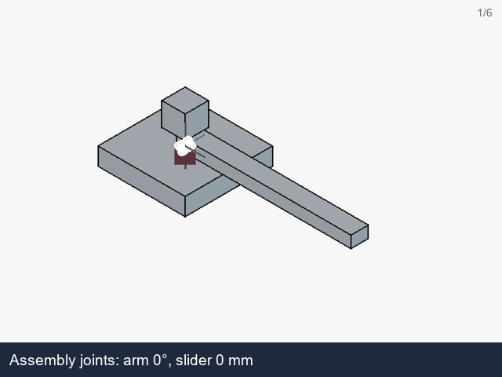

# FreeCAD MCP Server

[](https://paypal.me/jthiessen80) &nbsp; 
[](https://x.com/JakobThiessen) &nbsp;
[](https://www.linkedin.com/in/jakob-thie%C3%9Fen-06369038a) &nbsp;

[English](README.md) | **Deutsch**

Ein MCP Server der Claude (und andere AI-Assistenten) direkt mit einer laufenden FreeCAD-Instanz verbindet: 194 Werkzeuge fuer Dokumente, Parameter, Geometrieauswahl, Messung, Sketcher, Part, PartDesign, native Assembly, TechDraw, Draft, Mesh und Austausch. Die vereinbarten CAD-Aufgaben lassen sich ueber strukturierte Werkzeuge erledigen, ohne Python zu schreiben. Er deckt den vereinbarten Kernumfang ab, nicht saemtliche Workbenches oder Funktionen.

<p align="center"></p>
<p align="center"><sub>**Flanschwelle** (118 mm, Flansch Ø60), ausschliesslich mit MCP-Werkzeugen gebaut: Profilskizze, Revolution, Verrundungen/Fasen, Nut, Passfedernut, Senkbohrungen und Polarmuster.</sub></p>

<table>
  <tr>
    <td></td>
    <td></td>
  </tr>
  <tr>
    <td></td>
    <td></td>
  </tr>
</table>

<sub>Alle vier Demos entstanden ausschliesslich mit den strukturierten MCP-Werkzeugen (keine Python-Ausfuehrung): Gehaeuseaufbau, Parameteraenderung, TechDraw-Ansichten, Baugruppengelenke. Frames stammen aus `capture_view` und `techdraw_export_page`; siehe [docs/media/README.md](docs/media/README.md).</sub>

**Wichtig zu wissen**

- Batches: `execute_batch` fuehrt 1..100 Schritte aus elf erlaubten Operationen aus; atomar in einem Dokument, mit explizitem Teilstatus ueber mehrere Dokumente. `get_capabilities` meldet Versionen und Funktionen.
- Speichern und Loeschen: `save_document_safe` / `close_document_safe` verwenden (bestehende Dateien verlangen `overwrite=true`). `delete_object` lehnt referenzierte Objekte ab; dafuer `preview_delete` und `delete_objects` mit bestaetigter Menge nutzen.
- Die geometrische Auswahl ist revisionsgeprueft. Nach Modellaenderungen Auswahlen, Supports und Zielflaechen neu abfragen; bei `stale_selection` erneut geometrisch suchen. Alte EdgeN/FaceN-Strings haben keinen Revisionsschutz.
- Sketch-Koordinaten sind lokal XY. Part-Ableitungen (Offset, Schnitte usw.) sind statisch und werden bei Quellaenderungen nicht parametrisch nachgerechnet.
- Kollisions- und Kontaktpruefungen sind statisch; es gibt keine kontinuierliche Kollisions- oder Sicherheitszusage. Gueltige CAD-Geometrie sagt nichts ueber Festigkeit oder Fertigbarkeit aus.
- Freie Python-Ausfuehrung ist im Normalmodus deaktiviert.

**Stand:** Version 1.1.1 (Bridge-API 0.11.0), Referenzlaufzeit FreeCAD 1.1.4. FEM ist ausgeschlossen; CAM und BIM sind nicht aktiviert. Addon und MCP-Paket gemeinsam aktualisieren und MCP neu starten; die Benutzerinstallation wird nicht automatisch geaendert.
Details: [CHANGELOG.md](CHANGELOG.md), [docs/CONTRACTS.md](docs/CONTRACTS.md), [docs/COVERAGE.md](docs/COVERAGE.md), [memory.md](memory.md); verbleibende Grenzen: [Offene Punkte](#offene-punkte-und-roadmap).

## FreeCAD-Versionen

Referenz- und Ziel-Laufzeit ist **FreeCAD 1.1.4** (Sicherheitsfixes fuer
FCStd-Dateien); seit Wartungsschritt W2 (2026-11-11) ist dies die einzige
zugesagte Version. FreeCAD 1.1.1 ist **frueher geprueft** (Stufen 1-12a bis
2026-10-10), wird aber nicht mehr zugesagt oder nachgetestet. Die Capabilities
melden die Draft-/Mesh-/Austausch-/TechDraw-Zeichnungsfunktionen weiter fuer beide
Patches (`tested_versions` 1.1.1 und 1.1.4), andere Patches melden `false`.

| Funktion | 1.1.4 (zugesagt) | 1.1.1 (frueher geprueft) |
|---|---|---|
| `techdraw_scrub_edges` | geprueft | **geht nicht** (`unsupported_feature`, native API fehlt) |
| TechDraw (uebrige 14 Tools) | geprueft | geprueft |
| Draft, Mesh, Austausch (12 Tools), STEP-Schemawahl | geprueft (W2) | geprueft |
| Alle uebrigen Tools | geprueft (W2: native 60/60, `--stage12-only` 30/30) | geprueft |

Legende: **geht nicht** = Funktion auf dieser Version nicht verfuegbar.
Bekannte 1.1.4-Eigenheiten (W2): Undo/Redo/Rollback korrigieren eine native
Endpunktverschiebung von Draft-Wires; das aktive Dokument ist GUI-eigener
Zustand und kann nach kurz inaktivem Hauptfenster zurueckspringen. Details in
[docs/CONTRACTS.md](docs/CONTRACTS.md).

## Normaler Betrieb

Freie Python-Ausfuehrung ist standardmaessig gesperrt, auch fuer direkte RPC-
`execute`-Aufrufe. `execute_python` bleibt als kompatibler Toolname registriert,
ist aber kein CAD-Ausweg. Strukturierte Tools laufen ueber die GUI-Queue und
die Modul-/Funktionsallowlist. Loopback ist keine Authentifizierung oder Sandbox;
nur vertrauenswuerdige lokale Clients und Dokumente verwenden.

Entwicklermodus verlangt vor dem Start der FreeCAD-Bridge exakt
`FREECAD_MCP_ALLOW_RAW_PYTHON=1`; fehlend, `0` oder `true` schalten ihn nicht ein.
Das ist freie Codeausfuehrung mit Prozessrechten, keine Sandbox. Fuer normalen
Betrieb Variable entfernen oder `0` setzen und `get_capabilities` pruefen:
`features.raw_python_enabled=false`, `options.normal_mode.raw_python_disabled=true`.
Eine bestehende Benutzersitzung nicht ungefragt neu starten.

Addon und Hostpaket nur nach Zustimmung gemeinsam aktualisieren, anschliessend
einen neuen MCP-Prozess starten und Capabilities sowie geladene Pfade/Hashes
pruefen: `get_capabilities` liefert `bridge_install` (Pfad, SHA-256 des geladenen Addons) und
`compatibility` (`match`/`mismatch` mit Warnung, wenn Host und Addon verschiedene Bridge-Versionen haben).
Der Zyklus (Wheel + Addon-Kopie in einem TEMP-Mod-Ordner, nativer Autostart, Update, Rueckrollen, MCP-Neustart,
Timeout, GUI-Prozessverlust) ist mit `.venv\Scripts\python.exe -B tests\stage12c_operations.py` reproduzierbar (nur TEMP,
eigene GUI-Prozesse). Keine automatische Installation. Update: FreeCAD schliessen, Addon-Ordner ersetzen
(alte Kopie loeschen, neue kopieren), Host mit `pip install --upgrade` aktualisieren, FreeCAD und MCP-Client neu starten.
`FREECAD_MCP_TOOLSETS` (optional, Umgebung des MCP-Prozesses) begrenzt die angebotene Toolliste, z.B. `core,sketch,partdesign`
(Toolsets: `core` immer, `sketch`, `part`, `partdesign`, `assembly`, `techdraw`, `draft`, `mesh`; unbekannter Name -> Startfehler; Standard
leer/`all` = alle 194 Tools). Die vollstaendige Toolliste ist ca. 0,5 MB Schema; `core` allein sind 69 Tools.
`FREECAD_MCP_TIMEOUT_SECONDS` (0,1..3600, Standard 30) setzt das Transport-Timeout des MCP-Prozesses; nach einem Timeout ist der
Ausgang unbekannt (kein automatischer Retry), nach GUI-Verlust sind alte Job-IDs `unknown`.

Reproduzierbarer Teiltest gegen eine eigene leere GUI aus
[tests/start_bridge.FCMacro](tests/start_bridge.FCMacro): expliziten freien
`FREECAD_TEST_PORT` fuer Makro und Host setzen, Raw-Python deaktivieren, getrennte
TEMP-Konfigurationen/Ready-Datei verwenden und
`.venv\Scripts\python.exe -B tests\mcp_smoke.py --stage12-only` ausfuehren.
Berichte, CAD-Dateien und Bilder entstehen unter TEMP; `success=true` dieses
Runners bedeutet nur dessen 15 Gates, nicht alle Varianten V. Neue Chats pruefen
Prozess, Port und Interpreter neu. Details und offene Gates: [memory.md](memory.md).

## Architektur

```
Claude (VS Code / Desktop)
    │ stdio (JSON-RPC / MCP Protocol)
    ▼
MCP Server (Python, MCP SDK 2.x)         ← src/freecad_mcp/
    │ XML-RPC (localhost:9875)
    ▼
FreeCAD Addon (Workbench)            ← freecad_addon/
    │ Queue → GUI Thread (QTimer)
    ▼
FreeCAD GUI (Live Updates!)
```

## Installation

### Schnellinstallation (ohne Repo-Klon)

Voraussetzung: Python 3.10+ und [pipx](https://pipx.pypa.io/) (oder [uv](https://docs.astral.sh/uv/)). FreeCAD vorher schließen.

```bash
pipx install freecad-mcp-server      # installiert den Host (stdio-MCP-Server)
freecad-mcp install-addon            # kopiert das FreeCAD-Addon in den Mod-Ordner
freecad-mcp doctor                   # prüft Addon-Hash, Versionen und Bridge-Verbindung
freecad-mcp print-config             # gibt den Eintrag für claude_desktop_config.json aus
```

> **PyPI-Stand:** Das Paket ist noch nicht veröffentlicht. Bis dahin aus einem Klon oder gebauten Wheel installieren:
> `pipx install .` (Repo-Root) oder `pipx install <Pfad zu freecad_mcp_server-1.1.1-py3-none-any.whl>`.

- `install-addon` schreibt nach `%APPDATA%\FreeCAD\v1-1\Mod\FreecadAIBridge` (Windows, FreeCAD 1.1; einziger geprüfter Standard). Mit `--target <Mod-Ordner>` anderer Ort (unter Linux/macOS Pflicht), `--dry-run` zeigt nur an, `--force` installiert eine identische Kopie neu oder ersetzt einen fremden Ordner. Eine vorhandene Kopie wird ersetzt; SHA-256 von alter und neuer Kopie werden gemeldet und die Kopie geprüft. Läuft FreeCAD, erscheint eine Warnung; danach FreeCAD neu starten.
- `doctor` vergleicht das mitgelieferte Addon, die installierte Kopie und (bei laufendem FreeCAD) die geladene Bridge (`get_capabilities.bridge_install`) und meldet Bridge-API 0.11.0, `mcp`-SDK und FreeCAD-Version. Optionen: `--target`, `--host`, `--port`, `--json`. Exit-Code 1 bei Abweichung oder fehlendem Addon; fehlende Bridge-Verbindung ist nur eine Warnung.
- `print-config` gibt den MCP-Client-Eintrag mit dem installierten Starter aus; `print-config --uvx` liefert stattdessen einen Eintrag mit `uvx --from freecad-mcp-server freecad-mcp` (Addon dann mit `uvx --from freecad-mcp-server freecad-mcp install-addon`).
- `freecad-mcp` ohne Argumente (oder `freecad-mcp serve`) startet den stdio-Server unverändert.
- Update: `pipx upgrade freecad-mcp-server`, dann `freecad-mcp install-addon`, dann FreeCAD und MCP-Client neu starten. Host und Addon immer zusammen aktualisieren.

### Manuelle Installation (aus einem Klon)

Die Schritte 1-4 unten sind die Alternative zur Schnellinstallation.

### 1. FreeCAD Addon installieren

Kopiere den `freecad_addon` Ordner nach FreeCAD's Mod-Verzeichnis:

Den tatsächlich verwendeten Benutzerpfad zeigt `FreeCAD.getUserAppDataDir()` in der FreeCAD-Python-Konsole. Bei FreeCAD 1.1 unter Windows ist er beispielsweise `%APPDATA%\FreeCAD\v1-1\`; ältere Installationen können den unversionierten Pfad verwenden.

```bat
:: Windows (CMD)
xcopy /E /I /Y freecad_addon "%APPDATA%\FreeCAD\v1-1\Mod\FreecadAIBridge"
```

```bash
# Linux
cp -r freecad_addon ~/.FreeCAD/Mod/FreecadAIBridge

# macOS
cp -r freecad_addon ~/Library/Preferences/FreeCAD/Mod/FreecadAIBridge
```

### 2. MCP Server installieren

Im geklonten Root-Verzeichnis des Repos:

```bash
# Virtuelle Umgebung erstellen und aktivieren
python -m venv .venv

# Windows
.venv\Scripts\activate
# Linux / macOS
source .venv/bin/activate

# Abhängigkeiten installieren
pip install -e .
```

### 3. Claude Desktop konfigurieren

Füge in `claude_desktop_config.json` hinzu (siehe `claude_desktop_config.example.json`):

Die Datei befindet sich unter:
- **Windows**: `%APPDATA%\Claude\claude_desktop_config.json`
- **macOS**: `~/Library/Application Support/Claude/claude_desktop_config.json`
- **Linux**: `~/.config/Claude/claude_desktop_config.json`

```json
{
  "mcpServers": {
    "freecad": {
      "command": "python",
      "args": ["-m", "freecad_mcp.server"],
      "env": {
        "PYTHONPATH": "C:\\Users\\<DeinName>\\FreeCad_MCP_Server\\src"
      }
    }
  }
}
```

> **Hinweis:** Passe den `PYTHONPATH` auf den absoluten Pfad zum `src`-Verzeichnis deines geklonten Repos an. Wenn du eine virtuelle Umgebung nutzt, trage statt `python` den vollen Pfad zur Python-Binary ein (z.B. `C:\\Users\\<DeinName>\\FreeCad_MCP_Server\\.venv\\Scripts\\python.exe`).

### 4. VS Code konfigurieren

Die `.vscode/mcp.json` ist bereits im Projekt enthalten — beim Öffnen des Repo-Ordners in VS Code wird der MCP-Server automatisch erkannt. Der `PYTHONPATH` zeigt relativ auf `src/` im Repo.

## Verwendung

1. **FreeCAD starten** — Das Addon startet automatisch den RPC-Server auf Port 9875
2. **Claude verwenden** — Die MCP Tools sind automatisch verfügbar
3. **Erstes Tool aufrufen**: `connect` um die Verbindung herzustellen

### Beispiel-Workflow

```
User: "Erstelle einen Würfel 20x20x20mm mit 2mm Fillet auf allen Kanten"

Claude ruft auf:
1. connect()
2. create_document("MyPart")
3. partdesign_body("Body")
4. create_sketch("Sketch", plane="XY", body_name="Body")
5. sketch_add_rectangle("Sketch", 0, 0, 20, 20)
6. partdesign_pad("Sketch", length=20)
7. partdesign_fillet("Pad", edges=["Edge1","Edge2",...,"Edge12"], radius=2)
8. screenshot(view="isometric")
```

## Verfügbare Tools (194)

### TechDraw (15)

- `techdraw_list_templates`, `techdraw_create_page`, `techdraw_create_view`,
  `techdraw_create_projection_group`, `techdraw_create_section`, `techdraw_create_detail`
- `techdraw_create_dimension`, `techdraw_create_annotation`, `techdraw_create_leader`,
  `techdraw_list_geometry`, `techdraw_set_layout`
- `techdraw_inspect_page`, `techdraw_update_page`, `techdraw_export_page` (PDF/SVG)
- `techdraw_scrub_edges` **(nur FreeCAD 1.1.4, nicht 1.1.1)**: 1..256 revisionsgepruefte Kanten; bereinigt Flaechenraender
  ueber die native API. Ergebnis ist ein statischer Part-Compound, Quellen bleiben
  unveraendert; ohne native API folgt `unsupported_feature`.

### Draft, Mesh und Austausch (12)

- Draft (5): `draft_create_element`, `draft_edit_element`, `draft_create_array`,
  `draft_edit_array`, `draft_inspect`
- Mesh (5): `mesh_create`, `mesh_inspect`, `mesh_repair`, `mesh_from_shape`, `mesh_to_shape`
- Austausch (2): `exchange_export`, `exchange_import` (STEP AP214/AP242, STL ASCII/binaer,
  OBJ, planares DXF/SVG; Informationsverluste werden gemeldet)

### Auftraege und Dokumentuebersicht

- `start_batch_job`, `get_job`, `cancel_job` (prozesslokal, nur wartende Auftraege abbrechbar)
- `list_objects_page` (begrenzte Dokumentuebersicht)

### Geometrieauswahl und Analyse (Stufe 4a/4b)

- `list_subelements`, `select_subelement`, `resolve_subelement`: kombinierte
  Typ-/Lage-/Richtungs-/Radius-/Groessenfilter, explizite Dokumente, mm/Grad,
  konservative Revisionspruefung statt stiller Kantenneuzuordnung.
- `measure_distance`, `measure_angle`, `check_interference`: endliche BReps,
  Linien-/Ebenenwinkel und getrennte Kennwerte fuer Abstand/Schnittvolumen.
- `highlight_subelements`, `get_view_state`, `capture_view`: GUI-Auswahl,
  Darstellungswerte und sieben gezielte Ansichten als native MCP-PNGs.
  Markierung und PNG-Inhalt sind getrennt; saveImage kann Hervorhebung ausblenden.
- Part-/PartDesign-Dress-ups akzeptieren ausgegebene Auswahlobjekte direkt
  in edges/faces; Batches behalten ihre bisherige begrenzte API.

### Dokumentbearbeitung und Parameter (Stufe 3)

- `inspect_document`, `activate_document`, `recompute_document`, `save_document_safe`, `close_document_safe`
- `create_container`, `set_container_members`, `set_body_tip`
- `get_properties`, `set_properties`, `get_expressions`, `set_expression`
- `create_spreadsheet`, `read_spreadsheet`, `set_spreadsheet_cells`, `set_spreadsheet_alias`
- `rename_object`, `copy_object`, `create_link`, `get_dependencies`, `preview_delete`, `delete_objects`

Neue Werkzeuge verlangen explizite Dokumentnamen und liefern `ContractResponse`;
immer `status` pruefen. MCP-Abnahme: `python tests/mcp_smoke.py --stage3-only`
gegen eine leere isolierte Workspace-Bridge mit `FREECAD_TEST_PORT`.

### Verbindung & Dokumente (12)

- `connect`, `get_status`, `get_capabilities`, `resolve_reference`
- `execute_batch` (mit `preview=true` fuer nichtmutierende Vorschau)
- `create_document`, `open_document`, `save_document`, `close_document`
- `list_objects`, `inspect_object`, `delete_object`

### Sketcher Geometrie und Bearbeitung (22)
- `create_sketch`
- `sketch_add_line`, `sketch_add_rectangle`, `sketch_add_circle`
- `sketch_add_arc`, `sketch_add_ellipse`, `sketch_add_bspline`
- `sketch_add_point`, `sketch_add_polygon`, `sketch_add_slot`
- `sketch_move_point`, `sketch_set_construction`, `sketch_delete_geometry`
- `sketch_add_external`, `sketch_delete_external`, `sketch_set_attachment`
- `sketch_trim`, `sketch_extend`, `sketch_fillet`, `sketch_copy`, `sketch_mirror`
- `sketch_info`

### Sketcher Constraints (24)
- `sketch_constrain_coincident`, `sketch_constrain_tangent`
- `sketch_constrain_perpendicular`, `sketch_constrain_parallel`
- `sketch_constrain_equal`, `sketch_constrain_symmetric`
- `sketch_constrain_horizontal`, `sketch_constrain_vertical`
- `sketch_constrain_lock`, `sketch_constrain_block`
- `sketch_constrain_distance`, `sketch_constrain_distance_x`, `sketch_constrain_distance_y`
- `sketch_constrain_angle`, `sketch_constrain_radius`
- `sketch_constrain_length`, `sketch_constrain_distance_x_between`, `sketch_constrain_distance_y_between`
- `sketch_constrain_angle_to_axis`, `sketch_constrain_diameter`, `sketch_constrain_point_on_object`
- `sketch_set_constraint_value`, `sketch_set_constraint_mode`, `sketch_delete_constraint`

### PartDesign Features (20)
- `partdesign_body`, `partdesign_datum`, `partdesign_pad`, `partdesign_pocket`
- `partdesign_revolution`, `partdesign_groove`
- `partdesign_loft`, `partdesign_sweep`
- `partdesign_subtractive_loft`, `partdesign_subtractive_pipe`
- `partdesign_hole`
- `partdesign_fillet`, `partdesign_chamfer`
- `partdesign_thickness`, `partdesign_draft`
- `partdesign_linear_pattern`, `partdesign_polar_pattern`, `partdesign_mirrored`
- `partdesign_multi_transform`, `partdesign_edit_feature`

### Part Primitives, Boolean & Kanten (10)
- `part_box`, `part_cylinder` (Teilwinkel 0 < angle <= 360), `part_sphere`, `part_cone`, `part_torus` (Masse > 0)
- `boolean_fuse`, `boolean_cut`, `boolean_common` (verschiedene Operanden, leere Ergebnisse abgelehnt)
- `part_fillet`, `part_chamfer` (revisionsgepruefte Kanten, parametrisch)

### Part- und Flaechenmodellierung (16)
- `part_wire`, `part_face`, `part_shell`, `part_solid`
- `part_extrude`, `part_revolve`, `part_loft`, `part_sweep` (`right_corner` = Gehrung, `round` = Rundecke)
- `part_validate`, `part_section`, `part_split`
- `part_offset_2d`, `part_offset_shape` (3D nur `arc`/`intersection`), `part_refine`, `part_sew`, `part_repair`

### Transform (5)
- `set_placement`, `move_object`, `rotate_object` (um den Objektursprung), `scale_object` (0 < Faktor <= 1e6, um den globalen Ursprung), `mirror_object` (XY/XZ/YZ)

### Native Assembly (8)

- `assembly_create`, `assembly_add_component`, `assembly_set_grounded`
- `assembly_create_joint`, `assembly_set_joint`, `assembly_set_component_pose`
- `assembly_inspect`, `assembly_check_collisions`

### View & Visualisierung (6)
- `screenshot`, `set_view`, `fit_view`
- `set_visibility`, `set_color`, `set_transparency`

### Export/Import (5)
- `export_step`, `export_stl`, `export_obj`, `import_step`, `import_stl`

### Utilities (4)
- `measure`, `undo`, `redo`, `execute_python`

## Konfiguration

Das Addon kann über FreeCAD-Preferences konfiguriert werden:

- **Port**: Standard 9875 (änderbar in `User parameter:BaseApp/Preferences/Mod/FreecadAIBridge`)
- **Host**: Standard 127.0.0.1 (nur lokal)
- **AutoStart**: Standard True

## Sicherheit

- Der RPC-Server erzwingt eine lokale Loopback-Adresse und hat keine Authentifizierung. Nur vertrauenswürdige lokale Clients zulassen; den Port nicht weiterleiten.
- Funktionsaufrufe sind auf öffentliche, im Addon definierte Operationen beschränkt. Fremde Module und private Hilfsfunktionen sind gesperrt.
- `execute_python` und der XML-RPC-Pfad `execute` sind standardmaessig gesperrt
  (`raw_python_disabled`). Nur fuer vertrauenswuerdige Entwickler:
  `FREECAD_MCP_ALLOW_RAW_PYTHON=1` vor dem Start von FreeCAD setzen.
  Das Tool bleibt zur API-Kompatibilitaet registriert. Der Textfilter im
  Entwicklermodus ist **keine Sandbox**; Code hat die Rechte von FreeCAD.
- Öffnen, Speichern und Exportieren dürfen lokale Dateien lesen beziehungsweise überschreiben. Pfade vor dem Aufruf prüfen.

## Bekannte Einschränkungen

- FreeCAD muss laufen (kein headless Mode für GUI-Updates)
- Topology Naming Problem: Edge/Face-Namen können sich nach Recompute ändern
- Thread-Safety wird durch Queue-Pattern sichergestellt (kein direkter Zugriff)
- Kein FEM-Support in v1 (erweiterbar)
- Assembly setzt FreeCAD 1.1 voraus. Exakte DoF werden nur fuer einen vollstaendig
  verbundenen, azyklischen Gelenkbaum mit genau einer Fixierung ausgegeben.
  Bewegung ist diskret, Kollision statisch; keine Dynamik- oder Sicherheitszusage.
- PartDesign-Loft/-Sweep erzeugen Volumenkörper; `solid=False` wird ausdrücklich abgelehnt.
- Neue Part-Bildungs-/Offset-/Reparaturwerkzeuge erzeugen statische Shape-Ableitungen mit `SourceNames`; spaetere Quellaenderungen recomputen sie nicht parametrisch.
- Part-Reparatur ist auf explizite Toleranzen bis 1 mm begrenzt und keine universelle Heilungszusage; Sewing schliesst in FreeCAD 1.1 nur nachweislich koinzidente Flaechen.
- Pipe unterstuetzt konstante Profile sowie Standard/Frenet und transformed/right/round; keine variablen Mehrprofil-Pipes.
- `partdesign_draft` benötigt `plane_name`, etwa `Pad.Face6` oder den Namen einer Bezugsebene.
- Muster akzeptieren Origin- oder Datumachsen/-ebenen; MultiTransform ist auf Linear/Polar/Mirrored begrenzt.
- RPC-Modellieroperationen in bestehenden Dokumenten unterstützen Undo/Redo und Rollback bei Fehlern. Freie Python-Skripte müssen ihre Transaktionen selbst verwalten.
- Bei Zeitüberschreitungen werden noch nicht gestartete Aufträge verworfen. Bereits laufende CAD-Berechnungen können weiterlaufen; vor Wiederholung den Dokumentzustand prüfen.
- Standardexport: sichtbare Endergebnisse, keine ausgeblendeten Zwischenfeatures oder doppelten Body-Tips. `obj_names=[]` ist eine leere Auswahl und ergibt einen Fehler.
- `screenshot` liefert nativen MCP-Bildinhalt. `set_placement(rx, ry, rz)` verwendet X-/Y-/Z-Winkel, angewandt in dieser Reihenfolge.

## Tests und Prüfstand

Geprüft mit FreeCAD 1.1 unter Windows. Befunde, Änderungen und Grenzen stehen im [Prüfbericht](docs/AUDIT.md).

```powershell
python -m unittest discover -s tests -p "test_*.py" -v
```

Für isolierte Live-Tests eine zusätzliche FreeCAD-Instanz mit [tests/start_bridge.FCMacro](tests/start_bridge.FCMacro) öffnen. Diese lädt das Addon direkt aus dem Workspace und lauscht auf Port **9876**. Danach:

```powershell
python tests/mcp_smoke.py
```

Die CAD-Tests laufen intern in der isolierten Testinstanz, ohne den gesperrten
oeffentlichen Python-Pfad. Vor dem Start der Testinstanz setzen:

```powershell
$env:FREECAD_TEST_PORT = "9876"
$env:FREECAD_INTEGRATION_REPORT = "$env:TEMP\freecad-native-tests.json"
$env:FREECAD_INTEGRATION_PATTERN = "test_*"
```

Danach FreeCAD mit dem Testmakro starten. `FREECAD_INTEGRATION_PATTERN="test_export*"`
begrenzt den Lauf. Die Tests legen eigene Dokumente an und schliessen sie wieder.
`python tests/mcp_smoke.py --audit-only` prueft Normalmodus und API-Grenzen
ueber echten MCP-stdio-Transport gegen eine leere isolierte Workspace-Bridge.

Nach Addon-Updates FreeCAD neu starten; nach Änderungen am MCP-Werkzeugangebot auch den MCP-Server im Client neu starten.

## GitHub Copilot verwenden

Das Projekt lässt sich auch direkt mit **GitHub Copilot** (VS Code) nutzen. Die `.vscode/mcp.json` ist bereits im Repo enthalten und registriert den FreeCAD-MCP-Server automatisch.

### Voraussetzungen

- VS Code mit der Erweiterung **GitHub Copilot** (≥ v1.99) oder **GitHub Copilot Chat**
- MCP-Unterstützung ist in VS Code ab Version 1.99 integriert (Agent Mode)

### Einrichtung

1. Repo in VS Code öffnen
2. Virtualenv aktivieren und `pip install -e .` ausführen (siehe [Installation](#installation))
3. FreeCAD starten (Addon muss geladen sein, RPC-Server auf Port 9875)
4. In VS Code den **Copilot Chat** öffnen und in den **Agent Mode** wechseln (Dropdown oben im Chat-Fenster → „Agent")
5. Die FreeCAD-Tools erscheinen automatisch — einfach loslegen:

```
@workspace Erstelle in FreeCAD einen Zylinder mit Durchmesser 30mm und Höhe 50mm
```

> **Hinweis:** `mcp.json` setzt `PYTHONPATH` automatisch auf `${workspaceFolder}/src`, es ist kein manueller Eintrag nötig.

## Lizenz

MIT License — Copyright (c) 2026 JakobThiessen

Siehe [LICENSE](LICENSE) für den vollständigen Lizenztext.

## Offene Punkte und Roadmap

Stand 2026-11-19. Verbindlich bleiben [AGENTS.md](AGENTS.md), [memory.md](memory.md)
und [docs/COVERAGE.md](docs/COVERAGE.md). Stufen 1-11 sind im vereinbarten Umfang
geprueft (seit W2 auf FreeCAD 1.1.4; frueher 1.1.1). Stufe 12 abgenommen und freigegeben (2026-11-19).
Aenderungen je Schritt: [CHANGELOG.md](CHANGELOG.md).

### Wartungsplan (Details in [AGENTS.md](AGENTS.md), Fortschritt in [memory.md](memory.md))

- [x] **W1** MCP-SDK auf `>=1.30.0,<2` begrenzen und pruefen (2026-11-10: mcp 1.30.0,
  194 Schemas identisch zu 1.27.1, 55/55 Hosttests, `--stage12-only` 30/30 auf FreeCAD 1.1.4;
  Erstlauf auf frisch gestarteter 1.1.4-GUI SDK-unabhaengig instabil, Befund an W2)
- [x] **W2** FreeCAD 1.1.4 als Referenzlaufzeit abnehmen, Capabilities anpassen (2026-11-11:
  native 2x 60/60, `--stage12-only` 30/30 auf frischen 1.1.4-GUIs, Draft-Wire-Undo-Fix,
  Aktivdokument als GUI-Zustand; nur noch 1.1.4 zugesagt, 1.1.1 frueher geprueft)
- [x] **W3** Migration auf MCP-SDK 2.x (2026-11-19: mcp `>=2.3.0,<3`, geprueft mit 2.3.0: 68/68 Hosttests, 194 Schemas identisch zu 1.30.0, `--stage12-only` 50/50 auf FreeCAD 1.1.4)
- [ ] **W4** Kompatibilitaet FreeCAD 26.3 (offen: am 2026-11-19 nur 26.3rc1/rc2 veroeffentlicht, kein finales Release; keine Zusage)
- [x] **W5** Toolumfang: optionale Toolsets per `FREECAD_MCP_TOOLSETS` (Standard unveraendert alle 194 Tools, keine Migration)

### Stufe 12 (Gesamtabnahme und normaler Betriebsmodus)

- [x] **12b Einzelvarianten-Audit** (bestanden 2026-11-17): jede Matrixfunktion/jeder Enum per echtem MCP-Transport
  mit positivem, ungueltigem/Grenz- und Mutations-/Edit-/Rollback-Nachweis. Teilstufen:
  - [x] 12b-1 Sketcher: alle Geometrien, Constraint-Varianten und Zeichenoperationen
    (2026-11-11, `--stage12b-sketcher-only` 2x1153 Aufrufe, sieben Fixes, siehe CONTRACTS)
  - [x] 12b-2a PartDesign Datum/Pad/Pocket/Revolution/Groove/Loft/Pipe (2026-11-11,
    `--stage12b-partdesign-a-only` 2x3259 Aufrufe, Datum-Fix und Migration D1-D10, siehe CONTRACTS)
  - [x] 12b-2b PartDesign Hole, Dress-ups, Muster/MultiTransform, Featurebearbeitung (2026-11-12,
    `--stage12b-partdesign-b-only` 2x7018 Aufrufe, Thickness-Migration und sieben Fixes, siehe CONTRACTS)
  - [x] 12b-3 Part: Primitive, Booleans, Dress-ups, Transformationen sowie Wire/Face/Extrusion/Revolution/Loft/Sweep/
    Shell/Solid und Section/Split/Offset/Validierung/Refine/Reparatur/Sewing (2026-11-13,
    `--stage12b-part-only` 2x5290 Aufrufe, Migration und sieben Fixes, siehe CONTRACTS)
  - [x] 12b-4a Assembly: Gelenk-Offset-/Limit-/Referenzvarianten (2026-11-16, `--stage12b-assembly-only` 2x, `clear_limits`, siehe CONTRACTS)
  - [x] 12b-4b Draft: Platzierung/Enums/Achsen/Grenzen (2026-11-17, `--stage12b-draft-only` 2x1767 Aufrufe, Wire-Placement-Fix, Grenzen, siehe CONTRACTS)
  - [x] 12b-4c Mesh/Austausch: Grenzen, Triangulation, SVG-Einheiten, degenerierte Kanten (2026-11-17, `--stage12b-mesh-only` 2x772 Aufrufe, siehe CONTRACTS)
  - [x] 12b-4d Altpfade (2026-11-17, `--stage12b-legacy-only` 2x, Migration save/close/screenshot, siehe CONTRACTS)  Altpfade (`close_document`, `save_document`, `screenshot`, `set_view`, `fit_view`, `cancel_job`, `techdraw_scrub_edges`)
  - [x] 12b-5 (Teil) kriterienweise Zuordnung von N19/A5 und A1-A3 (2026-11-17, `--stage12b-techdraw-only` 2x, ACCEPTANCE-Zuordnungstabelle, siehe CONTRACTS)
  - [x] 12b-5 Rest: kriterienweise Zuordnung A4 und N01-N07 (2026-11-17, `--stage12b-core-only` 2x, Migration siehe CONTRACTS)
  - [x] 12b-Gates in `--stage12-only` aufgenommen, Gesamtlauf 50/50 (2026-11-17, 12b abgeschlossen)
- [x] **12c Installation/Update/Betrieb** (2026-11-18, `tests/stage12c_operations.py` 2x PASS): nativer
  Addon-Autoload-/Updatezyklus mit installiertem Host-/Addon-Paar (das Wheel enthaelt nur das Hostpaket), MCP-Neustart,
  Versions-/Hash-Nachweis (`get_capabilities.bridge_install`/`compatibility`); kontrollierter Timeout-/Prozessverlust-/
  Neustartnachweis ueber echten MCP (`FREECAD_MCP_TIMEOUT_SECONDS`). Migration alter Joint-ViewProvider nachtraeglich erledigt (2026-11-18, siehe CONTRACTS).
- [x] **12d Gesamtfreigabe:** Kriterienaudit aller Pflichtkriterien bestanden; Benutzerfreigabe erteilt
  2026-11-19 (`--stage12-only` 50/50, nativ 84/84), Stufe 12 abgeschlossen.
- [x] Migration bereits gespeicherter Assembly-Gelenke, die vor dem Fix ohne nativen
  ViewProvider erzeugt wurden (Fehler `redrawJointPlacements` nach Reopen).
- [x] Eigene Test-GUIs verschwanden zwischen Laeufen: nicht reproduzierbar (2026-11-19, Benutzer: als abgeschlossen akzeptiert).

### Bekannte Luecken im implementierten Umfang

- Draft, Mesh, Austausch und TechDraw: Capabilities fuer FreeCAD 1.1.4 (zugesagt,
  W2) und 1.1.1 (frueher geprueft); `techdraw_scrub_edges` nur 1.1.4. Andere
  Patchversionen sind nicht zugesagt (siehe [FreeCAD-Versionen](#freecad-versionen)).
- Austausch: per-Face-/Link-Override-Farben sind per MCP nicht erzeugbar und ungeprueft (Komponentenfarbpaletten sind geprueft), externe Linkidentitaet, Parametrik,
  Constraints und Gelenke gehen verloren; STL/OBJ ohne Einheit, Material, Farbe, Struktur;
  DXF/SVG ohne Splines, CSS, Text, Bilder und 3D.
- Vereinbarte Grenzen (Benutzerentscheidung 2026-11-18, nicht Teil der Pflicht): Part-3D-Offset `tangent` (`unsupported_feature`),
  Sketcher Trim gegen Achsen/Ellipsen-Equal/beliebige Spline-Bearbeitung, Assembly-Gelenklimits werden gespeichert, aber vom Solver
  nicht erzwungen.
- Mesh: Nonmanifold-, ungueltige und selbstschneidende Netze sind nicht reparierbar.
- Part-Ableitungen sind statisch (kein parametrisches Nachrechnen der Quellen).
- Jobs: Register prozesslokal, laufende CAD-Berechnungen nicht abbrechbar,
  kein Lasttest mit 256 nativen Jobs.
- Assembly: Bewegung diskret, Kollision statisch, exakte DoF nur fuer azyklische
  Gelenkbaeume mit genau einer Fixierung.
- Release: v1.0.0 (Paket 1.0.0, Bridge-API 0.11.0); keine automatische Benutzerinstallation.
### Optionale spaetere Stufen (nur auf eigenen Auftrag)

- [ ] Stufe 13: CAM (Aufspannungen, Werkzeuge, Operationen, Werkzeugwege, Postprozessoren)
- [ ] Stufe 14: BIM/Arch (Bauelemente, Gebaeudestruktur, IFC)
- FEM bleibt ausgeschlossen.
