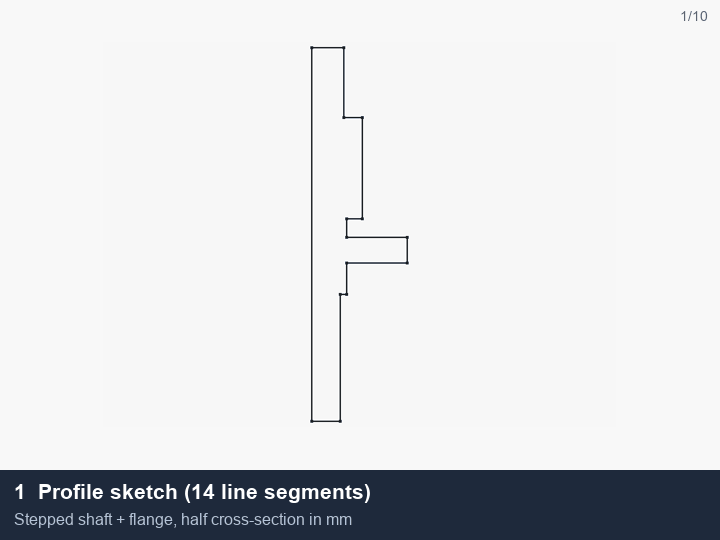
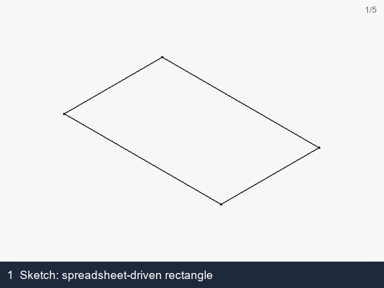
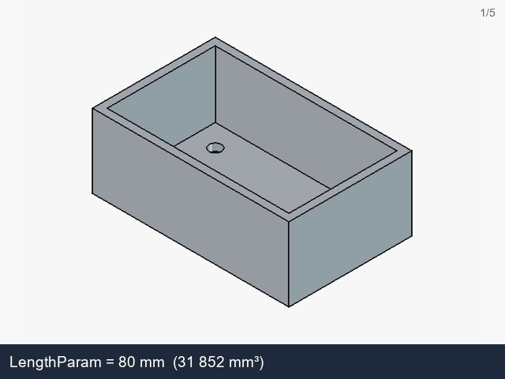
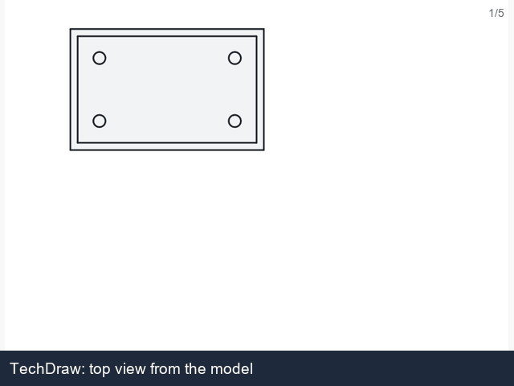
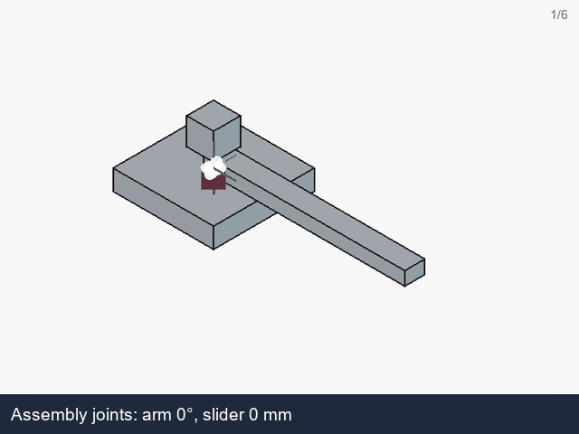

<p align="right">
  <a href="#freecad-versions"></a>
  <a href="#linux"></a>
</p>

# FreeCAD MCP Server

[](https://paypal.me/jthiessen80) &nbsp; 
[](https://x.com/JakobThiessen) &nbsp;
[](https://www.linkedin.com/in/jakob-thie%C3%9Fen-06369038a) &nbsp;

**English** | [Deutsch](README.de.md)

An MCP server that connects Claude (and other AI assistants) directly to a running FreeCAD instance: 194 tools for documents, parameters, geometry selection, measurement, Sketcher, Part, PartDesign, native Assembly, TechDraw, Draft, Mesh and exchange formats. The agreed CAD tasks can be done through structured tools, without writing Python. It covers the agreed core scope, not all workbenches or functions.

<p align="center"></p>
<p align="center"><sub>**Flanged shaft** (118 mm, flange Ø60), built only with MCP tools: profile sketch, revolution, fillets/chamfers, groove, keyway, counterbored holes and polar pattern.</sub></p>

<table>
  <tr>
    <td></td>
    <td></td>
  </tr>
  <tr>
    <td></td>
    <td></td>
  </tr>
</table>

<sub>All four demos were produced only with the structured MCP tools (no Python execution): housing build, parametric edit, TechDraw views, assembly joints. Frames come from `capture_view` and `techdraw_export_page`; see [docs/media/README.md](docs/media/README.md).</sub>

**Good to know**

- Batches: `execute_batch` runs 1..100 steps from eleven allowed operations; atomic within one document, explicit partial status across several documents. `get_capabilities` reports versions and features.
- Saving and deleting: use `save_document_safe` / `close_document_safe` (existing files need `overwrite=true`). `delete_object` rejects referenced objects; use `preview_delete` and `delete_objects` with a confirmed set.
- Geometry selection is revision-checked. After model changes, query selections, supports and target faces again; on `stale_selection` search geometrically again. Old EdgeN/FaceN strings have no revision protection.
- Sketch coordinates are local XY. Part derivations (offset, sections, etc.) are static and not recomputed parametrically when sources change.
- Collision and contact checks are static; there is no continuous collision or safety guarantee. Valid CAD geometry is no statement about strength or manufacturability.
- Free Python execution is disabled in normal mode.

**Status:** Version 1.1.2 (Bridge API 0.11.0), reference runtime FreeCAD 1.1.4. FEM is excluded; CAM and BIM are not activated. Update the addon and the MCP package together and restart MCP; the user installation is not changed automatically.
Details: [CHANGELOG.md](CHANGELOG.md), [docs/CONTRACTS.md](docs/CONTRACTS.md), [docs/COVERAGE.md](docs/COVERAGE.md), [memory.md](memory.md); remaining limits: [Open items](#open-items-and-roadmap).

## FreeCAD versions

Reference and target runtime is **FreeCAD 1.1.4** (security fixes for
FCStd files); since maintenance step W2 (2026-11-11) this is the only
supported version. FreeCAD 1.1.1 was **verified earlier** (stages 1-12a up to
2026-10-10), but is no longer supported or retested. Capabilities
still report the Draft/Mesh/exchange/TechDraw drawing functions for both
patches (`tested_versions` 1.1.1 and 1.1.4); other patches report `false`.

| Function | 1.1.4 (supported) | 1.1.1 (verified earlier) |
|---|---|---|
| `techdraw_scrub_edges` | verified | **does not work** (`unsupported_feature`, native API missing) |
| TechDraw (other 14 tools) | verified | verified |
| Draft, Mesh, exchange (12 tools), STEP schema selection | verified (W2) | verified |
| All other tools | verified (W2: native 60/60, `--stage12-only` 30/30) | verified |

Legend: **does not work** = function not available on this version.
Known 1.1.4 quirks (W2): Undo/Redo/rollback correct a native
endpoint shift of Draft wires; the active document is GUI-owned
state and may jump back after the main window was briefly inactive. Details in
[docs/CONTRACTS.md](docs/CONTRACTS.md).

## Linux

**Status:** tested on Ubuntu 24.04 under WSL2 with the FreeCAD 1.1.4 AppImage (Python 3.12, `mcp` 2.3.0). Windows stays the reference platform; a native Linux machine, Flatpak, distribution packages and macOS were **not** tested.

| Check on Linux | Result |
|---|---|
| `--stage12-only` (all 50 gates, normal mode, real MCP transport) | passed (1 h 02 min) |
| `stage12c_operations.py` (install/update, process loss, timeout) | passed (3 phases) |
| `--stage10a-render` (PDF/SVG render checks) | passed |
| Headless on a virtual display (Xvfb): contracts, 4a, 6, 9, 10a-render, 11a, 11bc | passed |
| `freecad-mcp doctor`, `install-addon` (default path found), host tests | passed (78/78) |

```bash
# AppImage without FUSE: extract once, then start the GUI (the addon starts the bridge on port 9875)
./FreeCAD_1.1.4-Linux-x86_64-py311.AppImage --appimage-extract
./squashfs-root/AppRun &            # start FreeCAD once so that ~/.local/share/FreeCAD/v1-1 exists

pipx install .                      # or: pip install -e . inside a venv
freecad-mcp install-addon           # -> ~/.local/share/FreeCAD/v1-1/Mod/FreecadAIBridge (or pass --target)
freecad-mcp doctor
```

- **Addon folder:** `FreeCAD.getUserAppDataDir()` returned `~/.local/share/FreeCAD/v1-1/`. `install-addon` uses it automatically if exactly one `FreeCAD/v1-1` folder exists; otherwise pass `--target`.
- **No display (server, CI):** start a virtual display and run FreeCAD on it, e.g. `Xvfb :99 -screen 0 1280x1024x24 +extension GLX &` and `DISPLAY=:99 LIBGL_ALWAYS_SOFTWARE=1 ./squashfs-root/AppRun`. Qt's `offscreen` platform is **not** suitable: it has no OpenGL context, so screenshots and 3D views fail (the AppImage's `AppRun` also forces `QT_QPA_PLATFORM=xcb`).
- **Tests on Linux:** `pip install pymupdf==1.28.2` (TechDraw render gate). `stage12c_operations.py` needs `FREECAD_TEST_EXE` (e.g. `squashfs-root/AppRun`) and `FREECAD_12C_OLD_PYTHON` (a venv with `mcp[cli]==1.30.0` for the old reference host) and must not run as root. Start every `--stage12-only` run on a fresh FreeCAD GUI and do not touch its window while the tests run.
- **Platform difference (solver):** the native Assembly solver breaks a tie at exactly +-90 deg offset rotation differently (Windows +90, Linux -90, both valid mirrored solutions); the test accepts both, other angles are identical.

## Normal operation

Free Python execution is blocked by default, including direct RPC
`execute` calls. `execute_python` remains registered as a compatible tool name,
but is not a CAD escape hatch. Structured tools run through the GUI queue and
the module/function allowlist. Loopback is not authentication or a sandbox;
use only trusted local clients and documents.

Developer mode requires exactly `FREECAD_MCP_ALLOW_RAW_PYTHON=1` before the
FreeCAD bridge starts; missing, `0` or `true` do not enable it.
This is free code execution with process privileges, not a sandbox. For normal
operation remove the variable or set `0` and check `get_capabilities`:
`features.raw_python_enabled=false`, `options.normal_mode.raw_python_disabled=true`.
Do not restart an existing user session without asking.

Update the addon and host package together and only with consent, then start
a new MCP process and check capabilities as well as loaded paths/hashes:
`get_capabilities` returns `bridge_install` (path, SHA-256 of the loaded addon) and
`compatibility` (`match`/`mismatch` with a warning if host and addon have different bridge versions).
The cycle (wheel + addon copy in a TEMP mod folder, native autostart, update, rollback, MCP restart,
timeout, GUI process loss) is reproducible with `.venv\Scripts\python.exe -B tests\stage12c_operations.py` (TEMP only,
own GUI processes). No automatic installation. Update: close FreeCAD, replace the addon folder
(delete the old copy, copy the new one), update the host with `pip install --upgrade`, restart FreeCAD and the MCP client.
`FREECAD_MCP_TOOLSETS` (optional, environment of the MCP process) limits the offered tool list, e.g. `core,sketch,partdesign`
(toolsets: `core` always, `sketch`, `part`, `partdesign`, `assembly`, `techdraw`, `draft`, `mesh`; unknown name -> startup error; default
empty/`all` = all 194 tools). The full tool list is about 0.5 MB of schema; `core` alone is 69 tools.
`FREECAD_MCP_TIMEOUT_SECONDS` (0.1..3600, default 30) sets the transport timeout of the MCP process; after a timeout the
outcome is unknown (no automatic retry); after GUI loss old job IDs are `unknown`.

Reproducible partial test against your own empty GUI from
[tests/start_bridge.FCMacro](tests/start_bridge.FCMacro): set an explicit free
`FREECAD_TEST_PORT` for macro and host, disable raw Python, use separate
TEMP configurations/ready file and run
`.venv\Scripts\python.exe -B tests\mcp_smoke.py --stage12-only`.
Reports, CAD files and images are created under TEMP; `success=true` of this
runner only means its 15 gates, not all variants V. New chats must re-check
process, port and interpreter. Details and open gates: [memory.md](memory.md).

## Architecture

```
Claude (VS Code / Desktop)
    │ stdio (JSON-RPC / MCP Protocol)
    ▼
MCP Server (Python, MCP SDK 2.x)         ← src/freecad_mcp/
    │ XML-RPC (localhost:9875)
    ▼
FreeCAD Addon (Workbench)            ← freecad_addon/
    │ Queue → GUI Thread (QTimer)
    ▼
FreeCAD GUI (Live Updates!)
```

## Installation

### Quick install (no repository clone)

Requires Python 3.10+ and [pipx](https://pipx.pypa.io/) (or [uv](https://docs.astral.sh/uv/)). Close FreeCAD first.

```bash
pipx install freecad-mcp-server      # installs the host (stdio MCP server)
freecad-mcp install-addon            # copies the FreeCAD addon into the Mod folder
freecad-mcp doctor                   # checks addon hash, versions and the bridge connection
freecad-mcp print-config             # prints the claude_desktop_config.json entry
```

> **PyPI status:** the package is not published yet. Until it is, install from a clone or a built wheel:
> `pipx install .` (repository root) or `pipx install <path to freecad_mcp_server-1.1.2-py3-none-any.whl>`.

- `install-addon` writes to `%APPDATA%\FreeCAD\v1-1\Mod\FreecadAIBridge` (Windows, FreeCAD 1.1); on Linux it uses `~/.local/share/FreeCAD/v1-1/Mod/FreecadAIBridge` if exactly one existing FreeCAD `v1-1` folder is found (verified with the AppImage, see [Linux](#linux); macOS paths are unverified), otherwise pass `--target`. Use `--target <Mod folder>` for another location, `--dry-run` to preview, `--force` to reinstall an identical copy or replace a foreign folder. An existing copy is replaced; the SHA-256 of the old and new addon is reported and the copy is verified. It warns if FreeCAD is running; restart FreeCAD afterwards.
- `doctor` compares the packaged addon, the installed copy and (if FreeCAD is running) the loaded bridge (`get_capabilities.bridge_install`), and reports Bridge API 0.11.0, the `mcp` SDK and the FreeCAD version. Options: `--target`, `--host`, `--port`, `--json`. Exit code 1 on mismatch or missing addon; a missing bridge connection is only a warning.
- `print-config` prints the MCP client entry using the installed launcher; `print-config --uvx` prints a `uvx --from freecad-mcp-server freecad-mcp` entry instead (the addon is then installed with `uvx --from freecad-mcp-server freecad-mcp install-addon`).
- `freecad-mcp` without arguments (or `freecad-mcp serve`) starts the stdio server exactly as before.
- Update: `pipx upgrade freecad-mcp-server`, then `freecad-mcp install-addon`, then restart FreeCAD and the MCP client. Host and addon must be updated together.

### Manual installation (from a clone)

The steps 1-4 below are the alternative to the quick install.

### 1. Install the FreeCAD addon

Copy the `freecad_addon` folder to FreeCAD's Mod directory:

The user path actually in use is shown by `FreeCAD.getUserAppDataDir()` in the FreeCAD Python console. For FreeCAD 1.1 on Windows it is, for example, `%APPDATA%\FreeCAD\v1-1\`; older installations may use the unversioned path.

```bat
:: Windows (CMD)
xcopy /E /I /Y freecad_addon "%APPDATA%\FreeCAD\v1-1\Mod\FreecadAIBridge"
```

```bash
# Linux (FreeCAD 1.1, verified path)
mkdir -p ~/.local/share/FreeCAD/v1-1/Mod
cp -r freecad_addon ~/.local/share/FreeCAD/v1-1/Mod/FreecadAIBridge

# macOS
cp -r freecad_addon ~/Library/Preferences/FreeCAD/Mod/FreecadAIBridge
```

### 2. Install the MCP server

In the root directory of the cloned repo:

```bash
# Create and activate a virtual environment
python -m venv .venv

# Windows
.venv\Scripts\activate
# Linux / macOS
source .venv/bin/activate

# Install dependencies
pip install -e .
```

For a reproducible, tamper-resistant install, use the hash-pinned lockfile instead
(universal, Python 3.10+; `pip install --require-hashes` rejects any file whose hash differs):

```bash
pip install --require-hashes -r requirements.lock
pip install -e . --no-deps
```

Regenerate it after changing dependencies with
`uv pip compile pyproject.toml --universal --generate-hashes --python-version 3.10 -o requirements.lock`
and check it with `pip-audit -r requirements.lock`.

### 3. Configure Claude Desktop

Add to `claude_desktop_config.json` (see `claude_desktop_config.example.json`):

The file is located at:
- **Windows**: `%APPDATA%\Claude\claude_desktop_config.json`
- **macOS**: `~/Library/Application Support/Claude/claude_desktop_config.json`
- **Linux**: `~/.config/Claude/claude_desktop_config.json`

```json
{
  "mcpServers": {
    "freecad": {
      "command": "python",
      "args": ["-m", "freecad_mcp.server"],
      "env": {
        "PYTHONPATH": "C:\\Users\\<YourName>\\FreeCad_MCP_Server\\src"
      }
    }
  }
}
```

> **Note:** Set `PYTHONPATH` to the absolute path of the `src` directory of your cloned repo. If you use a virtual environment, enter the full path to the Python binary instead of `python` (e.g. `C:\\Users\\<YourName>\\FreeCad_MCP_Server\\.venv\\Scripts\\python.exe`).

### 4. Configure VS Code

`.vscode/mcp.json` is already included in the project — when you open the repo folder in VS Code, the MCP server is detected automatically. `PYTHONPATH` points relatively to `src/` in the repo.

## Usage

1. **Start FreeCAD** — the addon automatically starts the RPC server on port 9875
2. **Use Claude** — the MCP tools are available automatically
3. **Call the first tool**: `connect` to establish the connection

### Example workflow

```
User: "Create a 20x20x20mm cube with a 2mm fillet on all edges"

Claude calls:
1. connect()
2. create_document("MyPart")
3. partdesign_body("Body")
4. create_sketch("Sketch", plane="XY", body_name="Body")
5. sketch_add_rectangle("Sketch", 0, 0, 20, 20)
6. partdesign_pad("Sketch", length=20)
7. partdesign_fillet("Pad", edges=["Edge1","Edge2",...,"Edge12"], radius=2)
8. screenshot(view="isometric")
```

## Available tools (194)

### TechDraw (15)

- `techdraw_list_templates`, `techdraw_create_page`, `techdraw_create_view`,
  `techdraw_create_projection_group`, `techdraw_create_section`, `techdraw_create_detail`
- `techdraw_create_dimension`, `techdraw_create_annotation`, `techdraw_create_leader`,
  `techdraw_list_geometry`, `techdraw_set_layout`
- `techdraw_inspect_page`, `techdraw_update_page`, `techdraw_export_page` (PDF/SVG)
- `techdraw_scrub_edges` **(FreeCAD 1.1.4 only, not 1.1.1)**: 1..256 revision-checked edges; cleans face borders
  via the native API. The result is a static Part compound, sources remain
  unchanged; without the native API `unsupported_feature` follows.

### Draft, Mesh and exchange (12)

- Draft (5): `draft_create_element`, `draft_edit_element`, `draft_create_array`,
  `draft_edit_array`, `draft_inspect`
- Mesh (5): `mesh_create`, `mesh_inspect`, `mesh_repair`, `mesh_from_shape`, `mesh_to_shape`
- Exchange (2): `exchange_export`, `exchange_import` (STEP AP214/AP242, STL ASCII/binary,
  OBJ, planar DXF/SVG; information losses are reported)

### Jobs and document overview

- `start_batch_job`, `get_job`, `cancel_job` (process-local, only waiting jobs can be cancelled)
- `list_objects_page` (bounded document overview)

### Geometry selection and analysis (Stage 4a/4b)

- `list_subelements`, `select_subelement`, `resolve_subelement`: combined
  type/position/direction/radius/size filters, explicit documents, mm/degrees,
  conservative revision check instead of silent edge reassignment.
- `measure_distance`, `measure_angle`, `check_interference`: finite BReps,
  line/plane angles and separate values for distance/intersection volume.
- `highlight_subelements`, `get_view_state`, `capture_view`: GUI selection,
  display values and seven targeted views as native MCP PNGs.
  Highlighting and PNG content are separate; saveImage may hide the highlight.
- Part/PartDesign dress-ups accept issued selection objects directly
  in edges/faces; batches keep their previous bounded API.

### Document editing and parameters (Stage 3)

- `inspect_document`, `activate_document`, `recompute_document`, `save_document_safe`, `close_document_safe`
- `create_container`, `set_container_members`, `set_body_tip`
- `get_properties`, `set_properties`, `get_expressions`, `set_expression`
- `create_spreadsheet`, `read_spreadsheet`, `set_spreadsheet_cells`, `set_spreadsheet_alias`
- `rename_object`, `copy_object`, `create_link`, `get_dependencies`, `preview_delete`, `delete_objects`

New tools require explicit document names and return `ContractResponse`;
always check `status`. MCP acceptance: `python tests/mcp_smoke.py --stage3-only`
against an empty isolated workspace bridge with `FREECAD_TEST_PORT`.

### Connection & documents (12)

- `connect`, `get_status`, `get_capabilities`, `resolve_reference`
- `execute_batch` (with `preview=true` for non-mutating preview)
- `create_document`, `open_document`, `save_document`, `close_document`
- `list_objects`, `inspect_object`, `delete_object`

### Sketcher geometry and editing (22)
- `create_sketch`
- `sketch_add_line`, `sketch_add_rectangle`, `sketch_add_circle`
- `sketch_add_arc`, `sketch_add_ellipse`, `sketch_add_bspline`
- `sketch_add_point`, `sketch_add_polygon`, `sketch_add_slot`
- `sketch_move_point`, `sketch_set_construction`, `sketch_delete_geometry`
- `sketch_add_external`, `sketch_delete_external`, `sketch_set_attachment`
- `sketch_trim`, `sketch_extend`, `sketch_fillet`, `sketch_copy`, `sketch_mirror`
- `sketch_info`

### Sketcher constraints (24)
- `sketch_constrain_coincident`, `sketch_constrain_tangent`
- `sketch_constrain_perpendicular`, `sketch_constrain_parallel`
- `sketch_constrain_equal`, `sketch_constrain_symmetric`
- `sketch_constrain_horizontal`, `sketch_constrain_vertical`
- `sketch_constrain_lock`, `sketch_constrain_block`
- `sketch_constrain_distance`, `sketch_constrain_distance_x`, `sketch_constrain_distance_y`
- `sketch_constrain_angle`, `sketch_constrain_radius`
- `sketch_constrain_length`, `sketch_constrain_distance_x_between`, `sketch_constrain_distance_y_between`
- `sketch_constrain_angle_to_axis`, `sketch_constrain_diameter`, `sketch_constrain_point_on_object`
- `sketch_set_constraint_value`, `sketch_set_constraint_mode`, `sketch_delete_constraint`

### PartDesign features (20)
- `partdesign_body`, `partdesign_datum`, `partdesign_pad`, `partdesign_pocket`
- `partdesign_revolution`, `partdesign_groove`
- `partdesign_loft`, `partdesign_sweep`
- `partdesign_subtractive_loft`, `partdesign_subtractive_pipe`
- `partdesign_hole`
- `partdesign_fillet`, `partdesign_chamfer`
- `partdesign_thickness`, `partdesign_draft`
- `partdesign_linear_pattern`, `partdesign_polar_pattern`, `partdesign_mirrored`
- `partdesign_multi_transform`, `partdesign_edit_feature`

### Part primitives, Boolean & edges (10)
- `part_box`, `part_cylinder` (partial angle 0 < angle <= 360), `part_sphere`, `part_cone`, `part_torus` (dimensions > 0)
- `boolean_fuse`, `boolean_cut`, `boolean_common` (distinct operands, empty results rejected)
- `part_fillet`, `part_chamfer` (revision-checked edges, parametric)

### Part and surface modeling (16)
- `part_wire`, `part_face`, `part_shell`, `part_solid`
- `part_extrude`, `part_revolve`, `part_loft`, `part_sweep` (`right_corner` = miter, `round` = round corner)
- `part_validate`, `part_section`, `part_split`
- `part_offset_2d`, `part_offset_shape` (3D only `arc`/`intersection`), `part_refine`, `part_sew`, `part_repair`

### Transform (5)
- `set_placement`, `move_object`, `rotate_object` (about the object origin), `scale_object` (0 < factor <= 1e6, about the global origin), `mirror_object` (XY/XZ/YZ)

### Native Assembly (8)

- `assembly_create`, `assembly_add_component`, `assembly_set_grounded`
- `assembly_create_joint`, `assembly_set_joint`, `assembly_set_component_pose`
- `assembly_inspect`, `assembly_check_collisions`

### View & visualization (6)
- `screenshot`, `set_view`, `fit_view`
- `set_visibility`, `set_color`, `set_transparency`

### Export/Import (5)
- `export_step`, `export_stl`, `export_obj`, `import_step`, `import_stl`

### Utilities (4)
- `measure`, `undo`, `redo`, `execute_python`

## Configuration

The addon can be configured via FreeCAD preferences:

- **Port**: default 9875 (changeable in `User parameter:BaseApp/Preferences/Mod/FreecadAIBridge`)
- **Host**: default 127.0.0.1 (local only)
- **AutoStart**: default True

## Security

- The RPC server enforces a local loopback address and has no authentication. Allow only trusted local clients; do not forward the port.
- Function calls are restricted to public operations defined in the addon. Foreign modules and private helper functions are blocked.
- `execute_python` and the XML-RPC path `execute` are blocked by default
  (`raw_python_disabled`). Only for trusted developers:
  set `FREECAD_MCP_ALLOW_RAW_PYTHON=1` before starting FreeCAD.
  The tool remains registered for API compatibility. The text filter in
  developer mode is **not a sandbox**; code runs with FreeCAD's privileges.
- Opening, saving and exporting may read or overwrite local files. Check paths before calling.

## Known limitations

- FreeCAD must be running (no headless mode for GUI updates)
- Topological naming problem: edge/face names may change after a recompute
- Thread safety is ensured by the queue pattern (no direct access)
- No FEM support in v1 (extensible)
- Assembly requires FreeCAD 1.1. Exact DoF are only reported for a fully
  connected, acyclic joint tree with exactly one grounding.
  Motion is discrete, collision is static; no dynamics or safety guarantee.
- PartDesign Loft/Sweep produce solids; `solid=False` is explicitly rejected.
- New Part forming/offset/repair tools produce static shape derivations with `SourceNames`; later source changes do not recompute them parametrically.
- Part repair is limited to explicit tolerances up to 1 mm and is not a universal healing guarantee; sewing in FreeCAD 1.1 only closes demonstrably coincident faces.
- Pipe supports constant profiles as well as Standard/Frenet and transformed/right/round; no variable multi-profile pipes.
- `partdesign_draft` requires `plane_name`, such as `Pad.Face6` or the name of a datum plane.
- Patterns accept origin or datum axes/planes; MultiTransform is limited to Linear/Polar/Mirrored.
- RPC modeling operations in existing documents support Undo/Redo and rollback on errors. Free Python scripts must manage their own transactions.
- On timeouts, jobs that have not started yet are discarded. CAD computations already running may continue; check the document state before retrying.
- Default export: visible end results, no hidden intermediate features or duplicate body tips. `obj_names=[]` is an empty selection and results in an error.
- `screenshot` returns native MCP image content. `set_placement(rx, ry, rz)` uses X/Y/Z angles, applied in that order.

## Tests and test bench

Verified with FreeCAD 1.1 on Windows. Findings, changes and limits are in the [audit report](docs/AUDIT.md).

```powershell
python -m unittest discover -s tests -p "test_*.py" -v
```

For isolated live tests, open an additional FreeCAD instance with [tests/start_bridge.FCMacro](tests/start_bridge.FCMacro). It loads the addon directly from the workspace and listens on port **9876**. Then:

```powershell
python tests/mcp_smoke.py
```

The CAD tests run internally in the isolated test instance, without the blocked
public Python path. Before starting the test instance, set:

```powershell
$env:FREECAD_TEST_PORT = "9876"
$env:FREECAD_INTEGRATION_REPORT = "$env:TEMP\freecad-native-tests.json"
$env:FREECAD_INTEGRATION_PATTERN = "test_*"
```

Then start FreeCAD with the test macro. `FREECAD_INTEGRATION_PATTERN="test_export*"`
limits the run. The tests create their own documents and close them again.
`python tests/mcp_smoke.py --audit-only` checks normal mode and API limits
over the real MCP stdio transport against an empty isolated workspace bridge.

After addon updates restart FreeCAD; after changes to the MCP tool offering also restart the MCP server in the client.

## Using GitHub Copilot

The project can also be used directly with **GitHub Copilot** (VS Code). `.vscode/mcp.json` is already included in the repo and registers the FreeCAD MCP server automatically.

### Prerequisites

- VS Code with the **GitHub Copilot** extension (≥ v1.99) or **GitHub Copilot Chat**
- MCP support is built into VS Code from version 1.99 (Agent Mode)

### Setup

1. Open the repo in VS Code
2. Activate the virtualenv and run `pip install -e .` (see [Installation](#installation))
3. Start FreeCAD (addon must be loaded, RPC server on port 9875)
4. In VS Code open **Copilot Chat** and switch to **Agent Mode** (dropdown at the top of the chat window → "Agent")
5. The FreeCAD tools appear automatically — just get started:

```
@workspace Create a cylinder in FreeCAD with a diameter of 30mm and a height of 50mm
```

> **Note:** `mcp.json` sets `PYTHONPATH` automatically to `${workspaceFolder}/src`; no manual entry is needed.

## License

MIT License — Copyright (c) 2026 JakobThiessen

See [LICENSE](LICENSE) for the full license text.

## Open items and roadmap

As of 2026-11-19. [AGENTS.md](AGENTS.md), [memory.md](memory.md)
and [docs/COVERAGE.md](docs/COVERAGE.md) remain binding. Stages 1-11 are verified
within the agreed scope (since W2 on FreeCAD 1.1.4; earlier 1.1.1). Stage 12 accepted and approved (2026-11-19).
Changes per step: [CHANGELOG.md](CHANGELOG.md).

### Maintenance plan (details in [AGENTS.md](AGENTS.md), progress in [memory.md](memory.md))

- [x] **W1** Limit MCP SDK to `>=1.30.0,<2` and verify (2026-11-10: mcp 1.30.0,
  194 schemas identical to 1.27.1, 55/55 host tests, `--stage12-only` 30/30 on FreeCAD 1.1.4;
  first run on a freshly started 1.1.4 GUI was unstable independent of the SDK, finding passed to W2)
- [x] **W2** Accept FreeCAD 1.1.4 as reference runtime, adjust capabilities (2026-11-11:
  native 2x 60/60, `--stage12-only` 30/30 on fresh 1.1.4 GUIs, Draft wire undo fix,
  active document as GUI state; only 1.1.4 supported now, 1.1.1 verified earlier)
- [x] **W3** Migration to MCP SDK 2.x (2026-11-19: mcp `>=2.3.0,<3`, verified with 2.3.0: 68/68 host tests, 194 schemas identical to 1.30.0, `--stage12-only` 50/50 on FreeCAD 1.1.4)
- [ ] **W4** Compatibility with FreeCAD 26.3 (open: on 2026-11-19 only 26.3rc1/rc2 released, no final release; no commitment)
- [x] **W5** Tool scope: optional toolsets via `FREECAD_MCP_TOOLSETS` (default unchanged, all 194 tools, no migration)

### Stage 12 (overall acceptance and normal operating mode)

- [x] **12b Individual-variant audit** (passed 2026-11-17): every matrix function/enum via real MCP transport
  with positive, invalid/boundary and mutation/edit/rollback evidence. Sub-stages:
  - [x] 12b-1 Sketcher: all geometries, constraint variants and drawing operations
    (2026-11-11, `--stage12b-sketcher-only` 2x1153 calls, seven fixes, see CONTRACTS)
  - [x] 12b-2a PartDesign Datum/Pad/Pocket/Revolution/Groove/Loft/Pipe (2026-11-11,
    `--stage12b-partdesign-a-only` 2x3259 calls, datum fix and migration D1-D10, see CONTRACTS)
  - [x] 12b-2b PartDesign Hole, dress-ups, patterns/MultiTransform, feature editing (2026-11-12,
    `--stage12b-partdesign-b-only` 2x7018 calls, Thickness migration and seven fixes, see CONTRACTS)
  - [x] 12b-3 Part: primitives, Booleans, dress-ups, transformations as well as Wire/Face/Extrusion/Revolution/Loft/Sweep/
    Shell/Solid and Section/Split/Offset/validation/Refine/repair/sewing (2026-11-13,
    `--stage12b-part-only` 2x5290 calls, migration and seven fixes, see CONTRACTS)
  - [x] 12b-4a Assembly: joint offset/limit/reference variants (2026-11-16, `--stage12b-assembly-only` 2x, `clear_limits`, see CONTRACTS)
  - [x] 12b-4b Draft: placement/enums/axes/limits (2026-11-17, `--stage12b-draft-only` 2x1767 calls, wire placement fix, limits, see CONTRACTS)
  - [x] 12b-4c Mesh/exchange: limits, triangulation, SVG units, degenerate edges (2026-11-17, `--stage12b-mesh-only` 2x772 calls, see CONTRACTS)
  - [x] 12b-4d Legacy paths (2026-11-17, `--stage12b-legacy-only` 2x, migration save/close/screenshot, see CONTRACTS)  Legacy paths (`close_document`, `save_document`, `screenshot`, `set_view`, `fit_view`, `cancel_job`, `techdraw_scrub_edges`)
  - [x] 12b-5 (part) criterion-by-criterion mapping of N19/A5 and A1-A3 (2026-11-17, `--stage12b-techdraw-only` 2x, ACCEPTANCE mapping table, see CONTRACTS)
  - [x] 12b-5 remainder: criterion-by-criterion mapping A4 and N01-N07 (2026-11-17, `--stage12b-core-only` 2x, migration see CONTRACTS)
  - [x] 12b gates included in `--stage12-only`, full run 50/50 (2026-11-17, 12b completed)
- [x] **12c Installation/update/operation** (2026-11-18, `tests/stage12c_operations.py` 2x PASS): native
  addon autoload/update cycle with installed host/addon pair (the wheel contains only the host package), MCP restart,
  version/hash evidence (`get_capabilities.bridge_install`/`compatibility`); controlled timeout/process-loss/
  restart evidence via real MCP (`FREECAD_MCP_TIMEOUT_SECONDS`). Migration of old joint ViewProviders completed afterwards (2026-11-18, see CONTRACTS).
- [x] **12d Overall approval:** criteria audit of all mandatory criteria passed; user approval granted
  2026-11-19 (`--stage12-only` 50/50, native 84/84), Stage 12 completed.
- [x] Migration of already saved Assembly joints that were created before the fix without a native
  ViewProvider (error `redrawJointPlacements` after reopen).
- [x] Own test GUIs disappeared between runs: not reproducible (2026-11-19, user: accepted as completed).

### Known gaps in the implemented scope

- Draft, Mesh, exchange and TechDraw: capabilities for FreeCAD 1.1.4 (supported,
  W2) and 1.1.1 (verified earlier); `techdraw_scrub_edges` only 1.1.4. Other
  patch versions are not supported (see [FreeCAD versions](#freecad-versions)).
- Exchange: per-face/link override colors cannot be produced via MCP and are untested (component color palettes are verified), external link identity, parametrics,
  constraints and joints are lost; STL/OBJ without unit, material, color, structure;
  DXF/SVG without splines, CSS, text, images and 3D.
- Agreed limits (user decision 2026-11-18, not part of the mandatory scope): Part 3D offset `tangent` (`unsupported_feature`),
  Sketcher Trim against axes/ellipse Equal/arbitrary spline editing, Assembly joint limits are stored but not enforced by the
  solver.
- Mesh: non-manifold, invalid and self-intersecting meshes are not repairable.
- Part derivations are static (no parametric recomputation of sources).
- Jobs: registry is process-local, running CAD computations cannot be cancelled,
  no load test with 256 native jobs.
- Assembly: motion discrete, collision static, exact DoF only for acyclic
  joint trees with exactly one grounding.
- Release: v1.0.0 (package 1.0.0, Bridge API 0.11.0); no automatic user installation.

### Optional later stages (only on explicit request)

- [ ] Stage 13: CAM (fixtures, tools, operations, toolpaths, postprocessors)
- [ ] Stage 14: BIM/Arch (building elements, building structure, IFC)
- FEM remains excluded.
